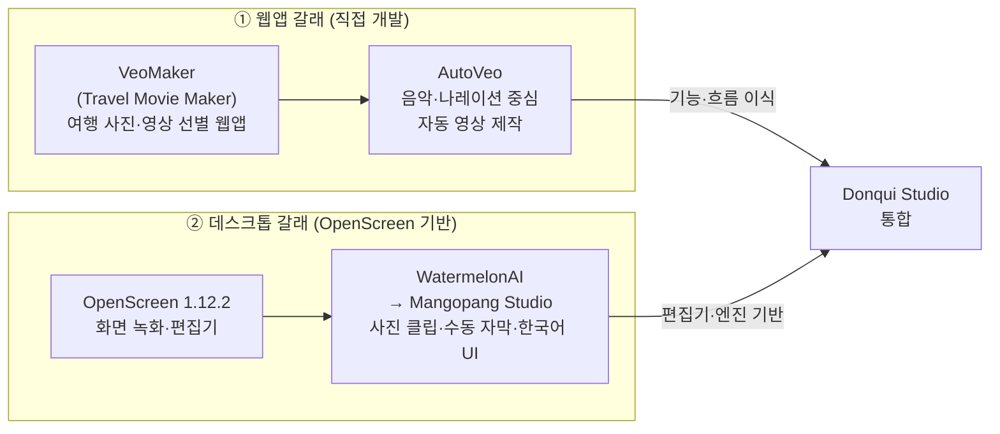
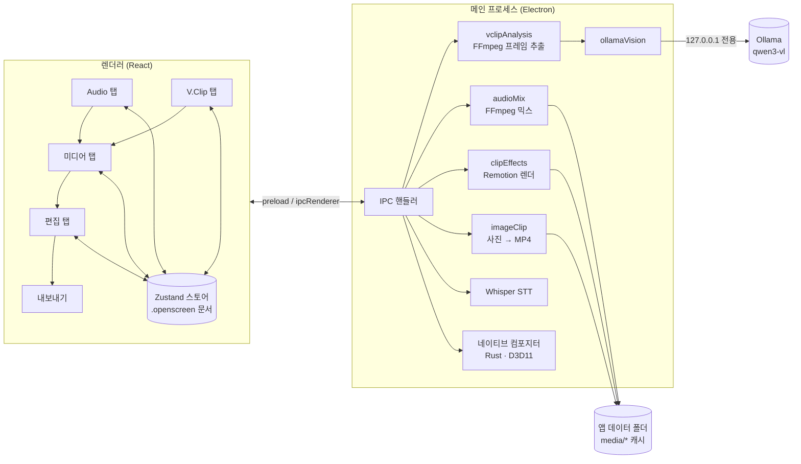

<p align="center">
  
</p>

<h1 align="center">Donqui Studio</h1>

<p align="center"><strong>음악·나레이션에 맞춰 사진과 촬영 영상을 자동으로 엮어 주는 데스크톱 영상 편집기</strong></p>

<p align="center">
  Electron · React · TypeScript · Remotion · FFmpeg · Ollama(로컬 비전 AI)
</p>

---

## 웹 버전 실행 및 Vercel 배포

브라우저 전용 편집기를 추가했습니다. 사진·영상·오디오 편집과 내보내기는 방문자의 기기에서 처리하며, GitHub 저장소를 Vercel에 연결해 정적 웹앱으로 배포할 수 있습니다.

```powershell
npm ci --ignore-scripts
npm run dev:web
```

배포 빌드는 `npm run build:web`, 출력 폴더는 `dist-web`입니다. Vercel 설정은 `vercel.json`에 포함되어 있습니다. **[GitHub / Vercel 배포 절차와 웹 기능 범위](docs/WEB-DEPLOYMENT.md)**를 확인하세요. 기존 데스크톱 실행·빌드 명령은 유지되며, 아래의 프로젝트 역사와 네이티브 기능 설명은 데스크톱 버전을 기준으로 합니다.

---

## 목차

1. [프로젝트 소개](#1-프로젝트-소개)
2. [개발 과정: 이전 작업과 기능 통합](#2-개발-과정-이전-작업과-기능-통합)
3. [주요 기능](#3-주요-기능)
4. [기술 스택](#4-기술-스택)
5. [시스템 구조](#5-시스템-구조)
6. [폴더 구조](#6-폴더-구조)
7. [설치 및 실행](#7-설치-및-실행)
8. [사용 방법](#8-사용-방법)
9. [단축키](#9-단축키)
10. [데이터 저장 방식](#10-데이터-저장-방식)
11. [테스트 및 검증](#11-테스트-및-검증)
12. [구현하면서 해결한 문제](#12-구현하면서-해결한-문제)
13. [한계와 향후 과제](#13-한계와-향후-과제)
14. [출처 및 라이선스](#14-출처-및-라이선스)

---

## 1. 프로젝트 소개

### 만든 이유

드론·액션캠으로 찍은 긴 원본 영상에서 쓸 만한 장면을 고르고, 배경음악 길이에 맞춰 자르고, 컷마다 효과를 넣는 일은 반복적이고 시간이 많이 듭니다. Donqui Studio는 이 과정을 **"오디오 → 장면 고르기 → 조합 → 마무리 편집 → 내보내기"** 의 한 흐름으로 묶고, 반복 작업을 자동화하는 것을 목표로 합니다.

- **Audio가 길이를 정한다** — 음악·나레이션을 먼저 배치하면, 영상과 사진이 그 길이에 맞춰 자동으로 늘거나 줄어듭니다.
- **AI가 장면을 고른다** — 이 컴퓨터에서 도는 Ollama 비전 모델이 영상 구간에 점수·설명·자막 초안을 붙여 좋은 장면부터 추천합니다. 영상 프레임은 외부로 전송되지 않습니다.
- **효과는 고르기만 한다** — 줌·이동·페이드·슬라이드 등 Remotion 효과를 항목마다 고르거나 랜덤으로 적용하고, 렌더링은 앱이 처리합니다.

### 한 줄 요약

직접 만들어 온 **음악 중심 자동 영상 제작 웹앱(AutoVeo)** 의 아이디어와, 오픈소스 데스크톱 편집기 **[OpenScreen](https://github.com/getopenscreen/openscreen)** (MIT) 의 편집·렌더링 기반을 **하나로 합친 프로젝트**입니다. 왜 합치게 되었는지는 [2. 개발 과정](#2-개발-과정-이전-작업과-기능-통합)에, 직접 구현한 범위는 [3. 주요 기능](#3-주요-기능)의 표에 정리했습니다.

---

## 2. 개발 과정: 이전 작업과 기능 통합

Donqui Studio는 처음부터 새로 만든 것이 아니라, **두 갈래로 따로 진행하던 작업을 비교한 끝에 합친 결과**입니다.

### 2-1. 진행 단계



| 시기 | 단계 | 한 일 |
|---|---|---|
| ~2026-08 | **VeoMaker** (Travel Movie Maker) | 여행 사진·영상을 내 컴퓨터에서 확인하고 장면을 골라 영상으로 만드는 웹앱. 원본은 읽기만 하고 외부로 올리지 않는 원칙을 세움 |
| 2026-08-27~ | **AutoVeo** | "소리가 길이를 정한다"는 방향으로 발전. 배경음악·나레이션을 분석해 칸(구간)을 나누고, 칸마다 영상 클립·사진을 채워 한 편으로 완성하는 6단계 파이프라인 |
| 2026-09-18~23 | **WatermelonAI → Mangopang Studio** | OpenScreen 1.12.2를 기반으로 한국어 시작 화면·차콜/청록 테마, 사진 → MP4 클립, 수동 자막을 추가. 이름을 WatermelonAI에서 Mangopang Studio로 변경 |
| 2026-09-23~24 | **Donqui Studio 통합 결정** | 두 갈래를 비교한 뒤(아래 2-2), OpenScreen 편집기를 기반으로 AutoVeo의 흐름을 옮기기로 결정. 이름과 아이콘을 Donqui(당나귀)로 바꾸고 기준 커밋을 만듦 |
| 2026-09-24 | V.Clip 탭 | AutoVeo의 "영상 클립" 단계 + Ollama 비전 모델 장면 분석 이식 |
| 2026-09-25 | 여러 영상 V.Clip, 미디어 조합, Audio 레이어 | 여러 원본을 한 화면에서 분석, Audio 길이에 맞춰 조합하는 미디어 탭, 여러 음원을 하나로 섞는 Audio 탭 |
| 2026-09-26 | Audio 클립·Media 타임라인·자막·설정 | 오디오 클립 라이브러리, 미디어 전용 타임라인, AutoVeo식 일반 자막/타이틀, 화면 비율·화질 설정 |

### 2-2. 두 프로젝트 비교: 비슷한 점과 장단점

두 프로젝트는 **"사진과 영상을 모아 한 편의 영상을 만든다", "원본은 수정하지 않고 모든 처리는 이 컴퓨터에서 한다", "Remotion·FFmpeg로 렌더링한다"** 는 점에서 같은 목표를 갖고 있었습니다. 하지만 잘하는 부분이 서로 반대였습니다.

| 비교 항목 | AutoVeo (직접 개발한 웹앱) | OpenScreen / Mangopang Studio (데스크톱) |
|---|---|---|
| 형태 | 브라우저 웹앱 + 로컬 서버 (React·Vite / Fastify·SQLite, pnpm 모노레포) | Electron 데스크톱 앱 (React·Zustand, 네이티브 컴포지터) |
| 실행 | PowerShell에서 서버를 띄우고 브라우저로 접속, 창을 닫으면 서버도 종료 | 앱 하나만 실행 |
| 영상 길이 결정 | ✅ **음악·나레이션이 길이와 컷 위치를 정함** (박자·말 끊김 분석) | ❌ 화면 녹화 기준, 음악에 맞춘 자동 구성 없음 |
| 장면 고르기 | ✅ **촬영 원본에서 구간을 잘라 쓰는 "영상 클립" 단계**, Ollama 비전 모델 | ❌ 녹화본 하나를 편집하는 구조 |
| 효과 | ✅ 효과 60종, 색감 필터, 사진 자동 그룹 구성 | ❌ 화면 녹화용 줌·커서 효과 중심, 사진·클립용 효과 없음 |
| 자막 | ✅ 일반 자막과 두 줄 타이틀 구분 | ✅ 음성 인식 자막(Whisper), 수동 자막(Mangopang) |
| 편집 자유도 | ❌ 단계별 버튼 실행 위주, 자유로운 타임라인 편집·실행 취소가 약함 | ✅ **완성된 타임라인 편집기** (자르기·이동·복제·속도·실행 취소/다시 실행) |
| 미리보기·내보내기 | ❌ 결과를 보려면 렌더를 기다려야 함 | ✅ **GPU 네이티브 실시간 미리보기와 빠른 MP4 내보내기** |
| 파일 다루기 | ❌ 음원은 `music/` 폴더 안의 mp3만 사용 | ✅ OS 파일 대화상자로 어디서나 가져오기 |
| 품질 기반 | 개인 프로젝트 수준의 검증 | ✅ 3,000개 넘는 단위 테스트, 15개 언어, 녹화·웹캠 등 검증된 기능 |

정리하면, **AutoVeo는 "무엇을 어떻게 엮을지"(음악 중심 자동 구성, 장면 선택, 효과)** 가 강하고 **"편집하고 내보내는 도구"로서는 약했습니다.** 반대로 **OpenScreen은 편집기·렌더링 엔진이 탄탄했지만 음악에 맞춰 촬영 원본을 엮는 기능이 없었습니다.** Mangopang Studio에서 사진 클립과 수동 자막을 넣어 보았지만, 편집기에 소재를 하나씩 손으로 놓아야 해서 AutoVeo의 자동화에는 미치지 못했습니다.

### 2-3. 통합 결정과 방법

**결정: OpenScreen(Mangopang Studio)을 바탕으로 두고, AutoVeo의 작업 흐름과 기능을 그 위로 옮긴다.**

반대 방향(AutoVeo에 편집기를 새로 만드는 것)도 검토했지만, 실시간 미리보기·타임라인 편집·실행 취소·GPU 내보내기를 웹앱에서 새로 만드는 것보다, 이미 검증된 편집기 위에 AutoVeo의 "앞단계"를 얹는 쪽이 훨씬 현실적이라고 판단했습니다. 역할은 이렇게 나눴습니다.

> **Audio는 소리에 맞추고, Media는 그림을 맞추고, Edit은 효과를 더한다.**

| AutoVeo 단계 | → | Donqui Studio | 옮기면서 바꾼 점 |
|---|---|---|---|
| 2단계 보이스 소스 (배경음악·나레이션) | → | **Audio 탭** | `music/` 폴더 제한 없이 가져오기, 여러 트랙 타임라인과 클립 라이브러리로 확장, FFmpeg로 하나의 WAV 믹스 |
| 3단계 영상 클립 (구간 자르기) | → | **V.Clip 탭** | 여러 원본을 한 화면에서, Ollama 비전 모델 분석을 단계 안에 통합, 원본 시작/끝만 기록해 즉시 나누기 |
| 1단계 이미지 소스 + 4단계 타임라인 (칸마다 소재 채우기) | → | **미디어 탭** | 칸 대신 "조합"과 전용 타임라인, **Audio 길이에 맞추기**·**나레이션 쉬는 곳에 컷 맞추기**로 자동 정렬 |
| 효과 60종 | → | **Remotion 효과 10종 + 랜덤** | 자주 쓰던 카메라·이동·전환 효과를 Remotion 컴포지션으로 옮기고, 항목마다 고르거나 랜덤 적용 |
| 5단계 자막 / 타이틀 | → | **편집 탭 자막 도구** | 일반 자막·타이틀 두 종류를 그대로 가져오고, N / Shift+N 빠른 입력과 SRT·VTT 가져오기 추가 |
| 영상 방향 · 최종 출력 설정 | → | **설정 대화상자** | 프로젝트별 화면 비율·화질·프레임, 내보내기 4K 단계 |
| 6단계 완성 (렌더 → 합성 → 검증) | → | **OpenScreen 내보내기** | 네이티브 컴포지터를 그대로 사용 |

OpenScreen에서는 편집 타임라인, 실행 취소, 음성 인식, 네이티브 미리보기·내보내기, 녹화, 다국어, 테스트 기반을 그대로 가져왔습니다. 기존 Mangopang Studio 사용자의 프로젝트·설정이 끊기지 않도록 앱 데이터 경로(`MangopangStudio`)와 테마 값도 유지했습니다.

### 2-4. 아직 옮기지 않은 AutoVeo 기능

통합은 진행 중이며, 다음 기능은 아직 Donqui Studio에 없습니다([13. 한계와 향후 과제](#13-한계와-향후-과제)).

- 박자(BPM)·마디 격자로 칸을 나누는 기능
- AI로 칸마다 영상·비슷한 사진을 묶는 그룹 자동 구성
- 효과 60종 중 나머지, 색감 필터
- 마스크 등장·블러·글로우 등 일부 타이틀 효과 (네이티브 컴포지터 재빌드 필요)

---

## 3. 주요 기능

### 이 프로젝트에서 새로 구현한 기능

| 영역 | 기능 |
|---|---|
| **Audio 탭** | 음악·나레이션 여러 파일 한 번에 가져오기, 오디오 클립 라이브러리(한 파일을 여러 번 배치), 여러 트랙 타임라인(드래그 이동·양끝 자르기·스냅·트랙 간 이동·복제·붙여넣기·끝까지 반복·트랙 음소거), 클립별 볼륨(0~400%)·페이드 인/아웃, 미리듣기, FFmpeg로 하나의 WAV(48kHz 스테레오)로 믹스, 클리핑 경고 |
| **V.Clip 탭** | 여러 촬영 원본을 한 화면에서 관리, 영상마다 최대 12개 구간을 **로컬 Ollama 비전 모델**로 분석(점수·장면 종류·설명·자막 초안), 겹치는 구간 자동 제거, 상위 3개 자동 선택, AI 없이 화질 점수(선명도·밝기·흔들림·움직임)만으로 분석, 구간 미리보기·경계 조정, "남은 Audio만큼 선택", 원본 시작/끝만 기록하는 즉시 클립 나누기 |
| **미디어 탭** | V.Clip 클립·사진·영상을 조합, 항목별 길이와 **Remotion 효과**(줌 인/아웃, 상하좌우 이동, 페이드, 슬라이드, 떠오르기, 시네마틱 틸트, 랜덤), Audio 믹스와 영상 줄이 있는 전용 타임라인, 전체 조합 미리보기(Remotion Player), **Audio 길이에 맞추기**(같은 장면이 두 번 나오지 않게 늘이기), **나레이션이 쉬는 곳에 컷 맞추기**, Edit 타임라인에 한 번에 반영(실행 취소 가능) |
| **편집 탭 – 자막** | 일반 자막(N)·타이틀(Shift+N) 빠른 입력 바, 종류별 모양·효과(페이드, 페이드 업, 스케일 펀치, 옆에서 밀기, 타자기, 강조 펄스), 자막 목록, SRT·VTT·일반 텍스트 가져오기, 미디어를 다시 반영해도 자막 유지 |
| **설정** | 프로젝트별 화면 비율(16:9 / 9:16 / 4:3 / 1:1 / 4:5), 화질(720p / 1080p / 4K), 프레임(24/30/60), 화면 구성(꽉 채우기 / 배경 위에 띄우기), 사진·영상 맞춤(cover / contain), 내보내기에 4K 단계 추가 |
| **공통** | 세 타임라인의 확대/축소(버튼·슬라이더·Ctrl+휠), Ollama 모델 선택 UI(15개 언어), 당나귀 아이콘·차콜/청록 테마·한국어 시작 화면, `start-donqui.cmd` 원클릭 실행(소스가 바뀌면 자동 재빌드), 실제 Electron을 구동하는 자동 검증 스크립트 |

### 기반(OpenScreen)에서 그대로 쓰는 기능

화면·창 녹화, 마이크/시스템 오디오, 웹캠 PiP, 자동·수동 줌, 커서 효과, 로컬 음성 인식 자막(Whisper), 편집 타임라인(자르기·속도·주석), GPU 기반 MP4/GIF 내보내기, 15개 언어 UI.

---

## 4. 기술 스택

### 언어·런타임

| 구분 | 사용 기술 | 버전 |
|---|---|---|
| 언어 | TypeScript (strict) | 5.9 |
| 런타임 | Node.js / npm | 22.22.1 / 10.9.4 |
| 데스크톱 프레임워크 | Electron | 41.2.1 |

### 프론트엔드 (렌더러)

| 사용 기술 | 용도 |
|---|---|
| **React 18** | UI (함수형 컴포넌트 + Hooks) |
| **Zustand** | 편집기 상태 관리 |
| **Tailwind CSS 3** + CSS Modules | 스타일링 (새 탭은 CSS Modules) |
| **Radix UI**, lucide-react | 대화상자·슬라이더·탭 등 접근성 있는 UI 부품, 아이콘 |
| **i18next** | 15개 언어 다국어 처리 |
| **Remotion Player** | 미디어 탭의 효과 미리보기·전체 조합 미리보기 |
| **Zod** | 프로젝트 문서(JSON) 스키마 검증 |
| motion, sonner, react-resizable-panels | 애니메이션, 알림 토스트, 패널 크기 조절 |

### 백엔드 (Electron 메인 프로세스)

| 사용 기술 | 용도 |
|---|---|
| **Electron IPC** (`preload.ts` → `ipc/handlers.ts`) | 렌더러 ↔ 메인 프로세스 통신, 파일 접근 |
| **FFmpeg** | 프레임 추출(키프레임만 디코딩), 오디오 믹스, 사진 → MP4 변환, 썸네일 |
| **Remotion Renderer / Bundler** | 효과 클립을 Chrome/Edge 헤드리스로 MP4 렌더링 |
| **Ollama** (HTTP, 루프백 전용) | 로컬 비전 모델(`qwen3-vl:4b` 등)로 장면 분석 |
| Whisper (whisper.cpp) | 나레이션 받아쓰기 → 자막·컷 위치 계산 |
| Rust 네이티브 컴포지터 (D3D11, napi-rs) | 편집 미리보기와 최종 MP4 내보내기 (OpenScreen 제공) |

### 빌드·품질 도구

| 사용 기술 | 용도 |
|---|---|
| **Vite 7** + vite-plugin-electron | 개발 서버, 렌더러·메인 번들링 |
| electron-builder | 설치 패키지 제작 |
| **Vitest 4** + Testing Library + jsdom | 단위·컴포넌트 테스트 |
| Playwright | Electron을 실제로 띄우는 E2E·스모크 검증 |
| fast-check | 속성 기반 테스트 |
| **Biome 2.4** | 린트 + 포맷 (탭, 큰따옴표, 100열) |

---

## 5. 시스템 구조



**데이터 흐름 요약**

1. **Audio** — 오디오 클립 배치 → `audioMix`가 FFmpeg로 하나의 WAV를 만들고, 그 WAV가 프로젝트의 유일한 오디오 트랙이 됩니다.
2. **V.Clip** — `vclipAnalysis`가 영상에서 고르게 퍼진 구간의 키프레임을 뽑아 화질 점수를 계산하고, `ollamaVision`이 로컬 모델에 보내 점수·설명을 받습니다. 결과는 파일·구간·모델 기준으로 캐시됩니다.
3. **미디어** — 조합 항목을 Audio 길이에 맞춘 뒤, 효과가 있는 항목만 `clipEffects`(Remotion)·`imageClip`(FFmpeg)으로 렌더링해 편집 타임라인에 한 번의 실행 취소 단위로 놓습니다. 효과 없는 클립은 원본에서 바로 재생합니다.
4. **편집·내보내기** — 자막·주석을 더하고 네이티브 컴포지터가 최종 MP4를 만듭니다.

모든 결과물은 **내용 해시 기반 캐시**를 쓰므로 같은 입력은 다시 계산하지 않고, 원본 파일은 절대 수정하지 않습니다.

---

## 6. 폴더 구조

이 프로젝트에서 추가·수정한 주요 파일 위주로 정리했습니다.

```text
Donqui-Studio/
├─ start-donqui.cmd                 # 원클릭 실행 (필요하면 자동 재빌드)
├─ electron/                        # 메인 프로세스
│  ├─ ipc/handlers.ts               # IPC 핸들러 (파일·렌더·분석 요청 처리)
│  ├─ preload.ts                    # 렌더러에 노출하는 안전한 API
│  └─ media/
│     ├─ audioMix.ts                # Audio 클립 → WAV 믹스 (FFmpeg)
│     ├─ vclipAnalysis.ts           # 구간 샘플링·화질 점수·캐시
│     ├─ ollamaVision.ts            # Ollama 비전 모델 호출 (루프백 전용)
│     ├─ clipEffects.ts             # Remotion 효과 클립 렌더링
│     └─ imageClip.ts               # 사진 → 프로젝트 프레임 MP4
├─ src/                             # 렌더러 (React)
│  ├─ components/ai-edition/
│  │  ├─ ProjectSettings.tsx        # 설정 대화상자 (비율·화질·프레임)
│  │  ├─ OllamaVisionSettings.tsx   # AI 설정 → 로컬 비전 모델
│  │  └─ v4/
│  │     ├─ AudioStage.tsx          # Audio 탭
│  │     ├─ AudioLayerTimeline.tsx  # Audio 타임라인
│  │     ├─ VClipStage.tsx          # V.Clip 탭
│  │     ├─ MediaStage.tsx          # 미디어 탭
│  │     ├─ MediaTimeline.tsx       # 미디어 타임라인
│  │     ├─ MediaPreview.tsx        # Remotion 조합 미리보기
│  │     ├─ SubtitleTools.tsx       # 자막 패널·빠른 입력 바
│  │     └─ TimelineZoom.tsx        # 타임라인 확대/축소
│  └─ lib/
│     ├─ audio-board/               # Audio 데이터 모델 (트랙·라이브러리)
│     ├─ media-board/               # 조합 모델, Audio 길이 맞추기(fit), 반영(apply)
│     ├─ vclip/                     # 구간 선택·겹침 제거 로직
│     └─ clip-effects/              # Remotion 컴포지션·효과 카탈로그
├─ scripts/
│  ├─ donqui-smoke.cjs              # 합성 소스로 전체 흐름 자동 검증
│  ├─ vclip-smoke.cjs               # 실제 촬영 영상으로 V.Clip~미디어 검증
│  └─ generate-donqui-icons.cjs     # 아이콘 생성
├─ public/donqui.svg                # 아이콘 원본
├─ DONQUI-VALIDATION.md             # 회차별 검증 기록
└─ README.openscreen.md             # 기반 프로젝트 원본 안내
```

---

## 7. 설치 및 실행

### 요구 사항

| 항목 | 내용 |
|---|---|
| OS | **Windows 10/11 (x64)** — 개발·검증한 환경 |
| Node.js / npm | 22.22.1 / 10.9.4 (반드시 npm 사용, `package-lock.json` 기준) |
| 브라우저 | Chrome 또는 Edge (Remotion 효과 렌더링용). 다른 위치라면 `DONQUI_CHROME_PATH`로 지정 |
| Ollama (선택) | AI 장면 분석용. 없으면 화질 점수만으로 동작 |
| 네이티브 바이너리 | `electron/native/bin/win32-x64/` (컴포지터, FFmpeg DLL, STT 등 — 소스와 맞는 전체 묶음) |

### 1) 의존성 설치

```bash
npm ci
```

### 2) 네이티브 구성요소 준비

`electron/native/bin/win32-x64/` 폴더 전체가 필요합니다. 이 폴더는 git에 포함되지 않으며 `npm run dev`·`npm run build-vite`로는 만들어지지 않습니다. 준비된 다른 체크아웃이나 같은 버전의 설치본에서 **폴더 전체**를 복사하세요(일부만 바꾸면 버전이 어긋나 내보내기가 실패할 수 있습니다). 직접 빌드하려면 Visual Studio C++·Rust 도구가 필요합니다 — 자세한 내용은 [AGENTS.md](AGENTS.md).

### 3) (선택) Ollama 비전 모델 설치

```bash
ollama pull qwen3-vl:4b
```

설치된 비전 모델 중 가장 가벼운 것이 기본으로 선택되며, 앱의 **AI 설정 → 로컬 비전 모델 (Ollama)** 에서 바꿀 수 있습니다.

### 4) 실행

- **간편 실행**: 프로젝트 폴더의 `start-donqui.cmd`를 더블클릭합니다. 소스가 마지막 빌드보다 새로우면 자동으로 `npm run build-vite`를 먼저 실행합니다.
- **개발 모드**(핫 리로드):

```bash
npm run dev
```

---

## 8. 사용 방법

상단 탭은 작업 순서대로 **Audio → V.Clip → 미디어 → 편집 → 녹화** 입니다. 기본 흐름은 *"Audio로 길이를 정하고, V.Clip으로 장면을 고르고, 미디어로 엮고, 편집에서 자막을 더해 내보낸다"* 입니다.

### 0단계 — 프로젝트와 화면 설정

1. 상단 **새 프로젝트**로 이름을 정합니다.
2. 당나귀 메뉴의 **설정**에서 화면 비율(유튜브 16:9, 쇼츠·릴스 9:16, 인스타그램 피드 4:5 등), 화질(720p·1080p·4K), 프레임(24·30·60)을 고릅니다. 다음 새 프로젝트도 이 설정으로 시작합니다.
   - **사진·영상 맞춤**: *화면 가득*(가장자리 조금 잘림) / *전체 보이기*(잘리지 않고 여백).
   - **화면 구성**: *꽉 채우기* / *배경 위에 띄우기*(여백·둥근 모서리).

### 1단계 — Audio: 음악과 나레이션 배치

1. **음악 가져오기**·**나레이션 가져오기**로 여러 파일을 한 번에 넣으면 **오디오 클립** 목록에 들어갑니다.
2. 카드의 **추가**를 누르거나 카드를 타임라인으로 끌어 놓습니다. 같은 파일을 몇 번이든 놓을 수 있습니다.
3. 타임라인에서 클립을 끌어 옮기고, 양 끝을 끌어 자릅니다(0초·재생 위치·다른 클립 끝에 붙음). 다른 트랙으로 옮길 수도 있습니다.
4. 클립을 누르면 오른쪽 **클립 설정**에서 볼륨(%)·페이드 인/아웃·시작·원본 구간·종류를 정합니다. **끝까지 반복**은 다른 트랙이 끝나는 곳까지 클립을 이어 붙입니다.
5. **미리듣기**로 설정대로 함께 들어 보고, **Media에 반영**을 누르면 하나의 오디오로 섞여 미디어 탭으로 넘어갑니다. 이후 Audio를 고치면 "다시 반영하세요"라고 알려 줍니다.

> 오디오 없이 사진·영상만으로 시작해도 됩니다.

### 2단계 — V.Clip: 촬영 원본에서 좋은 장면 고르기

1. **영상 가져오기**로 촬영 원본 여러 개를 한 번에 추가합니다. 모든 영상이 한 화면에 영상별로 나옵니다.
2. **클립 길이**(2~20초, 기본 5초)를 정하고 **모든 영상 구간 찾기**를 누릅니다. 영상마다 최대 12개 구간을 분석해 점수·장면 종류·설명·자막 초안을 붙이고, 좋은 구간 3개를 미리 선택합니다. 분석은 다른 탭으로 옮겨도 계속됩니다.
3. 카드의 **미리보기**로 구간만 반복 재생하며 **여기를 시작으로**·**여기를 끝으로**로 경계를 잡거나, −/+로 0.5초씩 밉니다. **구간 직접 추가**로 새 구간을 만들 수도 있습니다.
4. **넣기/빼기**로 고르거나, **남은 Audio만큼 선택**으로 음악 길이를 채울 만큼 좋은 구간부터 자동 선택합니다.
5. **선택한 구간 N개 클립으로 나누기**를 누르면 즉시 클립이 만들어져 미디어 탭의 **V.Clip 클립** 목록에 모입니다.

### 3단계 — 미디어: 클립·사진을 엮고 효과 넣기

1. 왼쪽 **소재**(V.Clip 클립·사진·영상)에서 **조합에 넣기** 또는 아래 **Media 타임라인**으로 끌어 놓습니다. **사진 추가**로 여러 장을 한 번에 가져올 수 있습니다(기본 5초).
2. 타임라인 윗줄은 Audio 믹스(파형, 나레이션 단어, 쉬는 곳 표시), 아랫줄은 영상·사진입니다. 항목을 끌어 순서를 바꾸고, 오른쪽 끝을 끌어 길이를, 왼쪽 끝을 끌어 앞부분을 자릅니다.
3. 항목을 고르면 **항목 효과**를 정합니다 — 줌 인·줌 아웃·상하좌우 이동·페이드·슬라이드·떠오르기·시네마틱 틸트, **효과 없음**, **랜덤 적용**. **새 항목 효과**는 앞으로 넣을 항목의 기본값입니다.
4. **Audio 길이에 맞추기**를 누르면 모든 항목이 비율대로 늘거나 줄어 Audio와 함께 끝납니다. 같은 영상에서 나눈 클립끼리는 쓰지 않은 장면으로만 늘어나 **같은 장면이 두 번 나오지 않습니다**.
5. 나레이션 받아쓰기가 끝났다면 **나레이션이 쉬는 곳에 컷 맞추기**로 컷을 말이 끊기는 자리로 옮깁니다.
6. 오른쪽 미리보기로 전체 조합을 음악과 함께 확인한 뒤 **Edit에 반영**(교체) 또는 **Edit 끝에 추가**를 누릅니다. 효과 있는 항목은 렌더링되며, 렌더링 중 **멈추기**로 중단할 수 있고 Ctrl+Z로 되돌릴 수 있습니다.

### 4단계 — 편집: 자막과 마무리

1. 재생 위치에서 **N**을 누르면 일반 자막, **Shift+N**을 누르면 타이틀 입력 바가 열립니다. Enter로 넣고, Ctrl+Enter로 넣은 뒤 바로 다음 자막을 이어 씁니다.
2. **자막** 패널에서 종류별 효과·글꼴·크기·색·배경 상자·위치를 정하면 그 종류의 모든 자막이 함께 바뀝니다. SRT·VTT 파일이나 일반 텍스트(한 줄에 자막 하나)를 가져올 수도 있습니다.
3. 필요하면 **클립 편집**에서 클립을 추가로 자르거나 이동·복제·삭제합니다.

### 5단계 — 내보내기

상단 **내보내기**에서 MP4를 선택합니다. 프로젝트 설정의 화질·프레임으로 열리며, 사진·영상·오디오·자막이 함께 출력됩니다.

---

## 9. 단축키

| 위치 | 키 | 동작 |
|---|---|---|
| Audio | Ctrl+D | 선택한 클립을 바로 뒤에 복제 |
| Audio | Ctrl+C / Ctrl+V | 복사 / 재생 위치에 붙여 넣기 |
| Audio | ← / → | 선택한 클립 미세 이동 |
| Audio | Delete | 클립 지우기 (파일은 목록에 남음) |
| 미디어 | Space / Home | 재생·일시 정지 / 처음으로 |
| 미디어 | ← / → (Shift: 1초) | 재생 위치 이동 |
| 미디어 | Alt+← / Alt+→ | 선택한 항목 순서 이동 |
| 미디어 | Ctrl+D / Delete | 항목 복제 / 조합에서 빼기 |
| 편집 | N / Shift+N | 일반 자막 / 타이틀 입력 |
| 편집 | Enter · F2 | 선택한 자막 고치기 |
| 편집 | [ / ] | 자막 시작 / 끝을 재생 위치로 |
| 편집 | = / - / \ | 타임라인 확대 / 축소 / 전체 맞춤 |
| 공통 타임라인 | Ctrl+휠 | 포인터 위치 기준 확대·축소 |
| 공통 | Ctrl+Z / Ctrl+Shift+Z | 실행 취소 / 다시 실행 |

---

## 10. 데이터 저장 방식

- **원본은 수정하지 않습니다.** 모든 파생 결과는 앱 데이터 폴더의 `media/` 아래에 만듭니다.

| 폴더 | 내용 | 캐시 기준 |
|---|---|---|
| `media/audio-mixes` | Audio 믹스 WAV (48kHz 스테레오) | 클립 배치 + 원본 |
| `media/vclip-analysis` | V.Clip 분석 결과 | 파일(경로·크기·수정 시각) + 구간 + 모델 |
| `media/vclip-thumbnails` | 구간 썸네일 | — |
| `media/clip-effects` | Remotion 효과 클립 | 원본 내용 + 효과 + 구간 + 프레임 + 버전 |
| `media/image-clips` | 효과 없는 사진 클립 | 내용 해시 + 변환 버전 + 길이 |

- **프로젝트 파일**(`.openscreen`, JSON)에 Audio(`audioBoard`), V.Clip 클립·조합(`mediaBoard`), 화면 설정, 자막 종류(`subtitleKind`)가 저장됩니다. 모두 선택 필드로 추가해 기존 프로젝트와 호환됩니다.
- **개인정보**: V.Clip 프레임은 루프백 주소(127.0.0.1)의 Ollama에만 보냅니다. `OLLAMA_HOST`가 다른 컴퓨터를 가리켜도 영상 프레임은 이 컴퓨터를 떠나지 않습니다.
- **호환성**: 이전 이름(Mangopang Studio)의 프로젝트·설정을 계속 찾도록 앱 데이터 경로 `MangopangStudio`와 `mangopang-theme` 값을 유지합니다. 개발용 분리 프로필은 `DONQUI_USER_DATA`로 지정합니다. 원본 OpenScreen 자동 업데이트 채널은 꺼 두었습니다.

---

## 11. 테스트 및 검증

### 정적 검사와 단위 테스트

```bash
npx tsc --noEmit
npx tsc -p tsconfig.test.json --noEmit
npm run lint
npm run test -- --maxWorkers=2
npm run i18n:check
```

마지막 전체 실행 결과(2026-09-26): **281개 파일, 3,432개 테스트 통과**(9개 건너뜀), 타입 검사·린트·i18n 검사 통과.

### 실제 앱을 띄우는 자동 검증

```powershell
node scripts/donqui-smoke.cjs
node scripts/vclip-smoke.cjs "C:\경로\촬영영상1.MP4" "C:\경로\촬영영상2.MP4" --photo="C:\경로\사진.jpg"
```

- `donqui-smoke.cjs` — 합성 소스로 **Audio 배치·믹스(음량 측정) → V.Clip 자르기 → 미디어 조합·맞추기·렌더 → 자막 입력 → 720p MP4 내보내기 → 재시작 후 재반영**까지 실제 Electron·FFmpeg·Remotion으로 10단계를 확인합니다.
- `vclip-smoke.cjs` — 실제 4K HEVC 드론 영상으로 분석(`--no-ai`면 화질 점수만) → 클립 나누기 → 사진과 랜덤 효과 조합 → 음악 길이 맞추기 → 타임라인 적용을 확인합니다.

### 측정값 (개발 PC, `qwen3-vl:4b`)

| 작업 | 소요 시간 |
|---|---|
| 4K HEVC 2분 47초 영상, 12개 구간 AI 분석 | 약 1분 |
| 5초 효과 클립 1개 렌더링 | 약 75초 |
| 1080p 효과 클립 4개 렌더링 (vclip-smoke) | 203초 |

회차별 상세 검증 범위·결과·미검증 항목은 [DONQUI-VALIDATION.md](DONQUI-VALIDATION.md)에 기록했습니다.

---

## 12. 구현하면서 해결한 문제

| 문제 | 원인 | 해결 |
|---|---|---|
| Qwen3-VL이 답 대신 긴 추론만 하다 응답이 잘림 | 모델이 `num_predict` 한도까지 생각 과정을 출력 | 응답을 `{`로 미리 채워 바로 JSON으로 답하게 함 |
| AI 점수가 거의 모두 85점으로 같음 | 작은 모델의 점수 분해능 부족 | 화질 점수(선명도·밝기·흔들림·움직임)를 동점 처리 기준으로 결합 |
| 같은 장면이 영상에 두 번 나옴 | 길이를 맞출 때 클립이 이웃 클립 구간까지 늘어남 | 같은 원본의 클립끼리는 쓰지 않은 구간만 나눠 쓰고, 모자랄 때만 알림과 함께 겹침 허용 |
| 미디어를 다시 반영하면 편집 탭 자막이 사라짐 | 클립 교체 시 클립에 묶인 자막까지 삭제 | 자막을 화면에 나오던 시각에 고정하고 새 클립에 다시 연결 |
| 4K HEVC 드론 영상 분석이 느림 | 전체 프레임 디코딩 | FFmpeg로 키프레임만 디코딩해 추출 |
| `start-donqui.cmd` 실행 시 "Error" 창 | `%~dp0` 끝의 `\`가 닫는 따옴표를 이스케이프 | 경로 대신 `.`로 앱 폴더 전달, `ELECTRON_RUN_AS_NODE` 해제 |
| 드롭 좌표가 없을 때 클립이 NaN초에 놓임 | 테스트 환경의 드래그 이벤트에 좌표 없음 | 좌표가 없으면 0초로 읽고 트랙 마지막 뒤에 배치 |

---

## 13. 한계와 향후 과제

- **플랫폼**: Windows에서만 개발·검증했습니다. macOS·Linux와 설치 프로그램은 아직 빌드·검증하지 않았습니다(현재는 개발 실행본).
- **해상도 검증 범위**: 실제 렌더·내보내기는 16:9 1080p/720p로 확인했습니다. 4K, 세로형(9:16) 등 다른 비율은 단위 테스트로만 확인했습니다.
- **자막 효과**: 네이티브 컴포지터가 그리는 6가지 효과만 지원합니다. 마스크 등장·블러·글로우·외곽선 등은 컴포지터(Rust) 재빌드가 필요해 이후 과제로 남겼습니다.
- **입력 검증**: 자동 검증은 Playwright/CDP 포인터 이벤트로 진행했으며, 실제 OS 마우스·키보드·한글 IME 입력으로 전 과정을 확인하지는 않았습니다.
- **향후**: AI 장면 추천으로 그룹 자동 구성, 음성 생성(TTS) 나레이션, 효과 렌더링 속도 개선.

---

## 14. 출처 및 라이선스

- **기반 프로젝트**: [OpenScreen](https://github.com/getopenscreen/openscreen) — MIT License. 원본 안내는 [README.openscreen.md](README.openscreen.md)에 보존했습니다.
- **라이선스**: [LICENSE](LICENSE) (MIT). 외부 구성요소 고지는 [THIRD-PARTY-NOTICES.md](THIRD-PARTY-NOTICES.md).
- **아이콘**: 원본은 `public/donqui.svg`이며 `scripts/generate-donqui-icons.cjs`가 sharp로 PNG·ICO·ICNS를 생성합니다(`npm run assets:appx`는 Windows 타일). 기존 OpenScreen 아이콘과 저작권 고지는 보존합니다.
- **개발 참고**: 코드 규칙·네이티브 바이너리 준비·릴리스 절차는 [AGENTS.md](AGENTS.md)와 [`technical-documentation/`](technical-documentation/) 참고.
